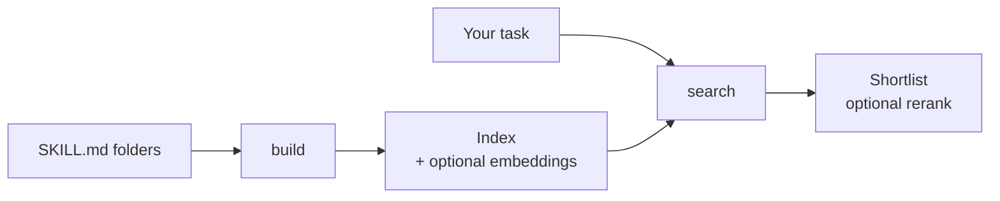

<div align="center">

<h1></h1>

**Find the right agent skill by describing the task, not by remembering its name.**

<a href="LICENSE"></a>


<a href="https://github.com/0xCydral/skillsonar/actions/workflows/test.yml"></a>

</div>

> [!NOTE]
> skillsonar ranks skills and prints the shortlist. It does not load or run them. The keyword search needs nothing but Python. Embeddings and rerank are optional and use services you run yourself.

**Users:** [What this is](#what-this-is) · [Status](#status) · [How it works](#how-it-works) · [What you need](#what-you-need) · [Install](#install) · [Usage](#usage) · [Evaluation](#evaluation) · [Troubleshooting and FAQ](#troubleshooting-and-faq) · [Contributing](#contributing)

**Developers:** [For developers](#for-developers)

## What this is

Claude Code, OpenCode, Codex and similar agents load skills: folders with a `SKILL.md` file that says what the skill does. After a few months you have dozens, spread over several directories, and the one you need is the one whose name you forgot.

skillsonar reads every `SKILL.md` it can find and ranks them against a sentence like "my pod keeps restarting". You type what you are trying to do. It prints the skills that look closest, with their descriptions and paths.

Plain keyword search matches words, so it misses a skill that says "OOMKilled" when you wrote "container got killed". For that case you can add an embedding index and search by meaning, or fuse both rankings. The [Evaluation](#evaluation) section measures the difference.

## Status

Version 0.4.0. It is a command-line tool with no interface of its own.

| Part | State | Notes |
|---|---|---|
| Keyword search | Works | Measured: recall@5 0.857 on the fixture set |
| Semantic search | Works | Needs Ollama with `bge-m3`. Measured: recall@5 0.964 |
| Hybrid search | Works | Keyword and semantic fused. Measured: recall@5 0.964 |
| Rerank | **Not measured** | Covered by unit tests with a stub. Never run against a real model |
| `eval` command | Works | recall@k over your own JSONL queries |

Tested on Linux and Windows (Python 3.10 and 3.13) by the [test workflow](.github/workflows/test.yml). macOS is not tested.

## How it works



1. **Build.** `skillsonar build` scans your skill folders and stores each skill as a set of stemmed words from its name, description and `when_to_use` text. Without a `when_to_use`, it uses the first lines of the body.
2. **Score.** A query scores every word it shares with a skill. A word counts for more the fewer skills contain it: "test" appears everywhere and adds little, "playwright" appears in a few and adds a lot. A word that is also in the skill's name counts one and a half times.
3. **Add meaning (optional).** `build --embed` sends each skill's name, description, headings and opening prose to an Ollama embeddings model. `--semantic` ranks by similarity of meaning. `--hybrid` fuses the keyword and embedding rankings.
4. **Rerank (optional).** `--rerank` sends the shortlist to a chat model in one call and keeps the order it returns. It only reorders what the first stage found.

The same skill is often copied into several folders (`~/.claude/skills`, `~/.agents/skills`, and so on). Skills with the same name are collapsed to the first one found, in the order of the folders listed under [Usage](#usage). Results show `also in: N other folder(s)` for it.

## What you need

| | |
|---|---|
| **Python** | 3.10 or newer. The core has no dependencies. |
| **Your skills** | Folders containing `SKILL.md` files. The defaults are listed under [Usage](#usage). |
| **Ollama with `bge-m3`** | Optional. Needed for `--embed`, `--semantic` and `--hybrid`. Run `ollama pull bge-m3`. |
| **A chat endpoint** | Optional. Any OpenAI-compatible server, for `--rerank` only. |
| **Disk** | The index is two JSON files in your user cache. |

## Install

```bash
pipx install git+https://github.com/0xCydral/skillsonar
skillsonar build
skillsonar search "my pod keeps restarting"
```

Without pipx, `python -m pip install git+https://github.com/0xCydral/skillsonar` works the same way. `python -m skillsonar` runs the same commands.

## Usage

### Build the index

`skillsonar build` scans these folders when they exist: `~/.claude/skills`, `~/.agents/skills`, `~/.config/opencode/skills`, and `./.claude/skills` and `./.opencode/skills` in the current directory. To index other folders instead, pass `--path DIR` (repeatable) or set `SKILLSONAR_PATHS`.

The examples below run against the 21 small skills in `tests/fixtures/skills`. Clone this repository to follow along. Paths are shown as they appear on Linux, with the default index location.

```console
$ skillsonar build --path tests/fixtures/skills --embed
indexed 21 skills from 1 folder(s) -> ~/.cache/skillsonar/index.json
embedded 21 skills with bge-m3 -> ~/.cache/skillsonar/embeddings.json
```

Leave out `--embed` if you only want keyword search.

### Search

```console
$ skillsonar search "my pod keeps restarting"
1. kubernetes-pod-debugging  (score 7.73)
   Diagnose Kubernetes pods that crash, restart repeatedly or stay Pending. Covers kubectl describe, logs, events...
   tests/fixtures/skills/kubernetes-pod-debugging
```

The task and the skill often describe the same problem in different words. Here the query says "container got killed", and the Kubernetes skill says "OOMKilled" and "pods". Keyword search returns only a memory-profiling skill. Hybrid search puts the Kubernetes skill second:

```console
$ skillsonar search "container got killed for using too much memory" --top 3
1. memory-leak-profiling  (score 4.64)
   Find memory leaks in long-running Node.js and Python services. Take heap snapshots, compare them over time and...
   tests/fixtures/skills/memory-leak-profiling

$ skillsonar search "container got killed for using too much memory" --hybrid --top 3
1. memory-leak-profiling  (score 0.03252)
   Find memory leaks in long-running Node.js and Python services. Take heap snapshots, compare them over time and...
   tests/fixtures/skills/memory-leak-profiling
2. kubernetes-pod-debugging  (score 0.01639)
   Diagnose Kubernetes pods that crash, restart repeatedly or stay Pending. Covers kubectl describe, logs, events...
   tests/fixtures/skills/kubernetes-pod-debugging
3. api-rate-limiting  (score 0.01587)
   Add rate limiting to an HTTP API with token bucket or sliding window counters, return 429 with Retry-After, an...
   tests/fixtures/skills/api-rate-limiting
```

> [!TIP]
> Scores from different modes are not comparable, and the third hybrid result above is noise. Read the descriptions. The output is a shortlist, not an answer.

| Flag | What it does |
|---|---|
| `--top N` | How many results to print. Default 5. |
| `--semantic` | Rank by embedding similarity only. Needs `build --embed`. |
| `--hybrid` | Fuse keyword and embedding rankings. Needs `build --embed`. |
| `--rerank` | Let a chat model reorder the shortlist. See [Rerank](#rerank-optional). |
| `--path DIR` | Only return skills under `DIR`. Repeatable. |
| `--json` | One object per result, for scripts and agents. |

### For scripts and agents

`--json` prints a list of objects. The `path` is absolute, shown here for a clone in `/home/you/skillsonar`:

```console
$ skillsonar search "my pod keeps restarting" --json --top 1
[
  {
    "name": "kubernetes-pod-debugging",
    "score": 7.7276,
    "source": "tests/fixtures/skills",
    "path": "/home/you/skillsonar/tests/fixtures/skills/kubernetes-pod-debugging",
    "desc": "Diagnose Kubernetes pods that crash, restart repeatedly or stay Pending. Covers kubectl describe, logs, events, OOMKilled and CrashLoopBackOff."
  }
]
```

When a skill was found in several folders, the object also has an `also` list with the other locations.

### Check the index

```console
$ skillsonar stats
index: ~/.cache/skillsonar/index.json
built: 2026-10-10T15:54:59-0500
skills: 21
duplicates collapsed: 0
  tests/fixtures/skills: 21
embeddings: bge-m3, 21 vectors
```

Without an index, commands stop with a message that names the fix:

```console
$ skillsonar search "anything" --index nope
skillsonar: no index at nope/index.json. Build one first: skillsonar build (add --path DIR to choose skill folders)
```

### Rerank (optional)

Point skillsonar at any OpenAI-compatible chat endpoint, then add `--rerank`:

```bash
export SKILLSONAR_RERANK_BASE_URL=https://api.openai.com/v1
export SKILLSONAR_RERANK_MODEL=<chat model name>
export SKILLSONAR_RERANK_API_KEY=<token>        # optional for local servers
skillsonar search "my pod keeps restarting" --hybrid --rerank
```

It sends the first-stage shortlist (150 skills by default, set with `--pool N`), with the name and the first 150 characters of the description of each, in one call. Because it only reorders what the first stage found, pair it with `--hybrid` on large catalogs. Rerank is covered by unit tests with a stub and has not been measured here.

### Choose folders and index location

| Setting | Meaning |
|---|---|
| `--path DIR` | `build`: the folders to index. Other commands: only return skills under `DIR`. |
| `SKILLSONAR_PATHS` | `build`: folders to index, separated by `:` (`;` on Windows). Replaces the defaults, like `--path`. |
| `--index DIR` | Where `index.json` and `embeddings.json` live. Default: `~/.cache/skillsonar` (`$XDG_CACHE_HOME/skillsonar` when set), or `%LOCALAPPDATA%\skillsonar` on Windows. |
| `OLLAMA_HOST` | Address of the embeddings server. Default `http://127.0.0.1:11434`. |

The full list is under [For developers](#for-developers).

## Evaluation

`skillsonar eval` reads a JSONL file with one `{"query": "...", "expected": ["skill-name"]}` object per line and prints recall@k: for each query, the share of its expected skills found in the top k, averaged over queries. It exits with an error if an expected name is not in the index.

`evals/queries.jsonl` holds 28 queries written as symptoms ("my pod keeps restarting") against the 21 fixture skills in `tests/fixtures/skills`. Measured on 2026-10-10, k = 5:

| Mode | recall@5 | Expected skill in top 5 | top-1 correct |
|---|---|---|---|
| keyword | 0.857 | 24 of 28 | 21 of 28 |
| semantic (bge-m3) | 0.964 | 27 of 28 | 25 of 28 |
| hybrid | 0.964 | 27 of 28 | 24 of 28 |

Reproduce it:

```bash
skillsonar build --path tests/fixtures/skills --index .demo --embed
skillsonar eval evals/queries.jsonl --index .demo --mode keyword   # or semantic, hybrid
```

`eval` lists every query it missed. This is the keyword run:

```console
$ skillsonar eval evals/queries.jsonl --index .demo --mode keyword
mode: keyword   queries: 28   k: 5
recall@5: 0.857   (every expected skill in top 5: 24/28; top-1 correct: 21/28)
  miss: 'container got killed for using too much memory'
        expected ['kubernetes-pod-debugging'], got ['memory-leak-profiling']
  miss: 'I cannot tell which service is slow when a request crosses five of them'
        expected ['observability-logging'], got ['flaky-test-triage', 'react-testing', 'sql-query-tuning', 'api-rate-limiting', 'github-actions-ci']
  miss: 'the build is green on my machine and red on the server about one run in ten'
        expected ['flaky-test-triage'], got ['github-actions-ci', 'regex-builder', 'memory-leak-profiling', 'python-packaging', 'api-rate-limiting']
  miss: 'set up HTTPS for my site'
        expected ['nginx-reverse-proxy'], got ['api-rate-limiting', 'csv-data-cleaning', 'pdf-form-filling', 'postgres-migrations']
```

> [!IMPORTANT]
> Read these numbers with their limits. The catalog is 21 skills, the author wrote both the queries and the skills, and each query has one expected skill. The table compares the three modes on the same data. It does not predict recall on a catalog of hundreds of real skills with overlapping descriptions. The semantic and hybrid rows used bge-m3 through a local Ollama server. Point `eval` at your own index and your own queries for a number that applies to you.

## Troubleshooting and FAQ

> [!TIP]
> When you report a problem, include the output of `skillsonar --version` and `skillsonar stats`, your Python version, your operating system and the exact command. The [issue forms](https://github.com/0xCydral/skillsonar/issues/new/choose) ask for these.

<details>
<summary><b>It says "no index at ... Build one first".</b></summary>

Run `skillsonar build`. Search, `stats` and `eval` read the index that `build` wrote. If you built it with `--index DIR`, pass the same `--index DIR` to the other commands.

</details>

<details>
<summary><b>It says "no skills found (looked in: ...)".</b></summary>

`build` only looks at the default folders that exist. If your skills live somewhere else, pass `--path DIR` or set `SKILLSONAR_PATHS`. `build` finds a skill wherever a folder holds a `SKILL.md`, at any depth. It skips hidden folders (names starting with a dot) and `node_modules`.

</details>

<details>
<summary><b>It says "no embeddings at ...".</b></summary>

`--semantic` and `--hybrid` need the embedding index. Run `skillsonar build --embed`. If it says the embeddings are out of date for this index, the index now holds skills the embeddings do not cover, for example after you added skills and ran `skillsonar build` without `--embed`. Run `skillsonar build --embed` again.

</details>

<details>
<summary><b>It says "embeddings failed ... is Ollama running?".</b></summary>

Start Ollama, or set `OLLAMA_HOST` to the address of the server. If the message says to run `ollama pull bge-m3`, the server is up but does not have the model. To use another model, set `SKILLSONAR_EMBED_MODEL`, and build the embeddings again with that model.

</details>

<details>
<summary><b>Keyword search misses a skill that clearly fits.</b></summary>

Keyword search matches words, not meaning, so "container got killed" does not find a skill that says "OOMKilled". Build with `--embed` and search with `--hybrid`. If you cannot run Ollama, rewrite the query with words the skill itself would use.

</details>

<details>
<summary><b>It prints "no matches".</b></summary>

Keyword search found no word your query shares with any skill. Rephrase the query, or use `--hybrid`.

</details>

<details>
<summary><b>It says "rerank is not configured".</b></summary>

`--rerank` needs `SKILLSONAR_RERANK_BASE_URL` and `SKILLSONAR_RERANK_MODEL`. `SKILLSONAR_RERANK_API_KEY` is optional for local servers.

</details>

<details>
<summary><b>The same skill shows up in two folders. Which one do I get?</b></summary>

The first one found, in the order of the default folders. Results say `also in: N other folder(s)`, `--json` lists the other locations under `also`, and `stats` counts how many copies were collapsed.

</details>

<details>
<summary><b>Does it send my skills anywhere?</b></summary>

Only if you ask it to. `build --embed`, `--semantic` and `--hybrid` send skill text and queries to the server named by `OLLAMA_HOST`, a local Ollama by default. `--rerank` sends the query and the shortlisted skill names and descriptions to the endpoint you configured. There is no telemetry and no update check. See [SECURITY.md](SECURITY.md).

</details>

<details>
<summary><b>Does it run on macOS?</b></summary>

Nobody has tested it. The code has no platform-specific part except the cache directory, which falls back to `~/.cache/skillsonar` outside Windows. The tests run in CI on Linux and Windows only.

</details>

## Contributing

Issues and pull requests are welcome. If a search returned the wrong skill, the [wrong result form](https://github.com/0xCydral/skillsonar/issues/new?template=wrong-result.yml) is the most useful report: it asks for the query, the skill you expected and the mode you used. Use the [bug report form](https://github.com/0xCydral/skillsonar/issues/new?template=bug.yml) for crashes and errors, and the [feature request form](https://github.com/0xCydral/skillsonar/issues/new?template=feature.yml) for ideas.

For code changes, read [CONTRIBUTING.md](CONTRIBUTING.md). In short: one concern per pull request, tests for new logic with outside services stubbed, and no new runtime dependencies. Report security problems as described in [SECURITY.md](SECURITY.md). Everyone taking part follows the [code of conduct](CODE_OF_CONDUCT.md).

---

## For developers

Everything below is reference material: the full list of settings, the repository layout, the tests and the licenses. Users do not need it.

### Settings and environment variables

| Setting | Applies to | Default |
|---|---|---|
| `--path DIR` (repeatable) | `build`: folders to index. Other commands: only return skills under DIR | the folders listed under [Usage](#usage) |
| `SKILLSONAR_PATHS` | `build`: folders to index, separated by `:` (`;` on Windows). Replaces the defaults, like `--path` | unset |
| `--index DIR` | all commands: directory holding `index.json` and `embeddings.json` | `%LOCALAPPDATA%\skillsonar` on Windows, `$XDG_CACHE_HOME/skillsonar` or `~/.cache/skillsonar` elsewhere |
| `--embed` | `build`: also build the embedding index | off |
| `--top N` | `search` | 5 |
| `--json` | `search` | off |
| `--semantic` / `--hybrid` | `search`: embedding-only or fused ranking (need `build --embed`). Mutually exclusive | keyword |
| `--rerank`, `--pool N` | `search`: rerank the first `N` candidates with a chat model | off, 150 |
| `--k N`, `--mode keyword\|semantic\|hybrid` | `eval` | 5, keyword |
| `--version` | print the version | |
| `OLLAMA_HOST` | embeddings server | `http://127.0.0.1:11434` |
| `SKILLSONAR_EMBED_MODEL` | embeddings model | `bge-m3` |
| `SKILLSONAR_RERANK_BASE_URL` | OpenAI-compatible endpoint, for example `https://api.openai.com/v1` | none, required for `--rerank` |
| `SKILLSONAR_RERANK_MODEL` | chat model name | none, required for `--rerank` |
| `SKILLSONAR_RERANK_API_KEY` | bearer token, optional for local servers | unset |
| `XDG_CACHE_HOME`, `LOCALAPPDATA` | read to find the default index directory | the system value |

How the ranking works, in detail:

- **Keyword weight.** A shared word is weighted `log(1 + N / df)`, with N the number of skills in the catalog and df the number of skills holding the word. A word that is also in the skill's name counts 1.5 times, so a common word in a name cannot outrank a skill that matches the rarer words. Contractions such as "doesn't" are ignored. Frontmatter block scalars (`description: |` and `description: >`) are parsed.
- **Hybrid fusion.** Reciprocal rank fusion with k = 60: a skill's score is the sum of 1/(60 + rank) over the rankings it appears in. Only the first 150 semantic results enter the fusion.
- **Score formats.** Keyword scores print with two decimals, semantic and hybrid scores with four significant digits. The scales differ by mode.
- **Rerank prompt.** The model is asked for the numbers of the best skills, best first. Out-of-range and repeated numbers are dropped. If the answer has no usable number, the first-stage order is kept.

### Repository layout

| Path | Contents |
|---|---|
| `src/skillsonar/cli.py` | Argument parsing and output. |
| `src/skillsonar/index.py` | `SKILL.md` parsing, scanning, duplicate collapsing, keyword scoring. |
| `src/skillsonar/semantic.py` | The embedding index and cosine ranking. |
| `src/skillsonar/search.py` | Keyword, semantic and hybrid modes, and the rerank pipeline. |
| `src/skillsonar/evaluate.py` | recall@k. |
| `src/skillsonar/ollama.py` | `OllamaClient`, the only code that talks to Ollama. |
| `src/skillsonar/rerank.py` | `RerankClient`, the only code that talks to the rerank model. |
| `src/skillsonar/paths.py` | Default skill folders and the cache directory. |
| `src/skillsonar/_http.py`, `errors.py` | The small JSON-over-HTTP helper and the error types. |
| `tests/` | Unit tests. `tests/fixtures/skills` holds the 21 skills used by the examples and the eval. |
| `evals/queries.jsonl` | The 28 evaluation queries. |
| `docs/` | The banner image. |

### Tests

```bash
git clone https://github.com/0xCydral/skillsonar
cd skillsonar
python -m pip install -e ".[dev]"
python -m pytest -q
python -m ruff check .
```

Tests use pytest and never touch the network. They stub `OllamaClient` and `RerankClient` (see `tests/conftest.py`).

### Formerly opencode-router

skillsonar was `opencode-router` up to version 0.3.3. Version 0.4.0 removes the agent routing, task orchestration and project memory, because in daily use the routing step did not earn its complexity. The skill search was the part worth keeping. The old `opencode-router` command is gone; use `skillsonar`. The history is in [CHANGELOG.md](CHANGELOG.md).

### Credits and licenses

skillsonar is licensed under the **MIT License** ([LICENSE](LICENSE)). It has no runtime dependencies and bundles no third-party code. The optional embeddings model (`bge-m3`) and the server that runs it (Ollama) are separate projects with their own licenses, and nothing from them is included here.
